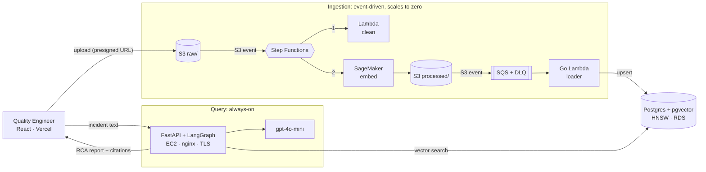

# RootCause AI

**Paste in a new vehicle incident and get a draft root-cause analysis back, with every claim tied to a real complaint from the NHTSA database.**

I built this for Quality Engineers, who currently spend hours digging through complaint data by hand to find similar cases. The tool does the digging. A second LLM step checks the draft before anyone sees it.

---

## How it works

## RAG Pipeline

`retrieve_node` → `analysis_node` → `evaluation_node` → (fail & under max_revision → back to `analysis_node`; pass or max_revision hit → `action_node`)

## Tech Stack

- **Orchestration**: LangGraph (StateGraph)
- **Embedding**: nomic-ai/nomic-embed-text-v1.5 (768-dim, HNSW m=24/ef_construction=200)
- **LLM**: gpt-4o-mini
- **Vector store**: Postgres + pgvector (RDS)
- **API**: FastAPI, deployed on EC2 behind nginx (TLS via Let's Encrypt)
- **Async worker**: Go, AWS Lambda (`provided.al2023`, arm64), SQS-triggered
- **Frontend**: React/TypeScript on Vercel
- **IaC**: manual for now, Terraform planned

## AWS

- **Region**: `ap-southeast-1`
- **S3**: `root-cause-ai` (`raw/` → cleaned by Lambda, `processed/` → embedded CSV output)
- **SQS**: `rootcause-load-queue` (event source mapping, `ReportBatchItemFailures` enabled)
- **RDS**: `rootcause-db` — PostgreSQL + pgvector, private subnet, `sslmode=require`
- **Lambda**: `rootcause-insert-worker` — Go, `provided.al2023`/arm64, VPC-attached
- **EC2**: RAG API host — Elastic IP + `<eip>.nip.io` domain for Let's Encrypt TLS
- **ECR**: `rootcause-api` repo
- **VPC**: S3 Gateway Endpoint attached to Lambda's route table (no NAT Gateway — keeps free tier)
- **Security Groups**: `lambda-worker-sg`, RDS SG, EC2 `default` SG — cross-referenced by SG id, not CIDR
- **IAM (Lambda execution role)**: `AWSLambdaVPCAccessExecutionRole`, `AWSLambdaSQSQueueExecutionRole`, inline `s3:GetObject` on `root-cause-ai/*`

All resources above are still hand-configured via Console, not Terraform — see [Known gaps](#known-gaps).

## Status

Demo/portfolio deployment, torn down between sessions. Not production-hardened (see [Known gaps](#known-gaps)).

> **Evidence rule.** Everything below comes from the project notes or from the AWS console / Cost Explorer screens checked on 2026-09-30. Text tagged *(inferred)*, *(hypothesis)*, *(suggestion)* or *(general)* is analysis, not a recorded fact. Incidents that are not on record are **not** listed — add them with the template in Appendix B.

The `evaluate` step works like a reviewer. It sends the draft back until every claim has a supporting complaint, and a hard cap on revisions stops the loop from running forever.

## Stack

| Layer | Tech |
|---|---|
| Orchestration | LangGraph |
| Embeddings | nomic-embed-text-v1.5 (768-d) |
| Vector store | Postgres + pgvector, HNSW |
| API | Python, FastAPI |
| Worker | Go on AWS Lambda (arm64) |
| Pipeline | S3, Step Functions, SageMaker Processing, SQS |
| Frontend | React + TypeScript |
| CI/CD | GitHub Actions → ECR / Lambda |

---

## What broke, and what I learned

**1. The default vector index quietly lost results.**
NHTSA has many near-duplicate complaints, and pgvector's default HNSW settings missed relevant matches. I caught it by comparing the index against exact brute-force search. Rebuilding with `m=24, ef_construction=200` fixed recall, and retrieval stays around 45 ms.
→ *Approximate search is approximate. Measure it on your own data.*

**2. The generator and the critic wanted opposite things.**
The analyzer was told to be honest about ambiguity, while the evaluator demanded exactly one root cause, so the loop never converged. I rewrote both prompts as one contract: 2–3 cited candidate causes is a valid answer. It now passes in 1–2 revisions.

**3. A real citation was attached to the wrong claim.**
The retrieved complaint was relevant to the topic but didn't describe the failure the report claimed. Semantic similarity is not causal evidence. I mitigated it in the prompts, but it isn't measured yet (see Next).

**4. 97% of the AWS bill came from idle infrastructure.**
The always-on parts (RDS, EC2, public IPs) cost about $8. The whole event-driven pipeline cost about $0.04. That's why the stack now comes up only for demos, and why I'm moving it to Terraform.

**A trade-off I'd make explicit:** for a static dataset, a script plus `COPY` would be enough. I built the event-driven version because the product accepts user uploads of unpredictable size, and because I wanted to run the production patterns myself.

Full write-up with every incident: [docs/RETROSPECTIVE.md](docs/RETROSPECTIVE.md)

## Status & next

Working end-to-end. It's a demo deployment, torn down between sessions, and the infrastructure is being moved from hand-built to Terraform.

- [Step Functions — service integration patterns](https://docs.aws.amazon.com/step-functions/latest/dg/connect-to-resource.html)
- [API Gateway — integration timeout beyond 29 s (June 2024)](https://aws.amazon.com/about-aws/whats-new/2024/06/amazon-api-gateway-integration-timeout-limit-29-seconds/)
- [Lambda — SQS event source mapping](https://docs.aws.amazon.com/lambda/latest/dg/services-sqs-configure.html)
- [pgvector 0.8.0 — iterative index scans](https://docs.pgedge.com/pgvector/v0-8-0/iterative-index-scans/)
- [SageMaker — ResourceLimitExceeded and quotas](https://repost.aws/knowledge-center/sagemaker-resource-limit-exceeded-error)
- [S3 uploads — presigned POST vs PUT](https://aws.amazon.com/blogs/networking-and-content-delivery/implementing-secure-file-uploads-to-amazon-s3-at-the-edge-choosing-the-right-pattern)
- [Amazon VPC pricing](https://aws.amazon.com/vpc/pricing/)
