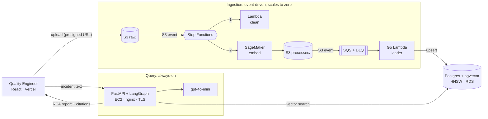
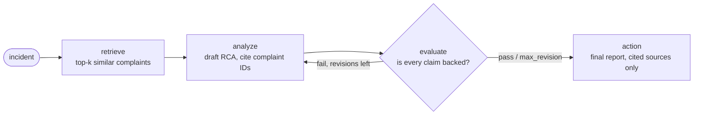

# RootCause AI

**Paste in a new vehicle incident and get a draft root-cause analysis back, with every claim tied to a real complaint from the NHTSA database.**

I built this for Quality Engineers, who currently spend hours digging through complaint data by hand to find similar cases. The tool does the digging. A second LLM step checks the draft before anyone sees it.

---

## How it works

- **Uploads go straight to S3** through a presigned URL, so large files never pass through the API.
- **Each stage writes to S3, and events carry only the file key.** Any stage can be re-run from the previous stage's output, and raw data stays untouched.
- **SQS sits in front of the database** and absorbs bursts. Failed messages go to a dead-letter queue.
- **The query API runs as a persistent service**, not a Lambda, because one report takes several LLM calls and needs a warm database pool.

## The RAG loop

The `evaluate` step works like a reviewer. It sends the draft back until every claim has a supporting complaint, and a hard cap on revisions stops the loop from running forever.

## Stack

| Layer | Tech |
|---|---|
| Orchestration | LangGraph |
| Embeddings | nomic-embed-text-v1.5 (768-d) |
| Vector store | Postgres + pgvector, HNSW |
| API | Python, FastAPI |
| Worker | Go on AWS Lambda (arm64) |
| Pipeline | S3, Step Functions, SageMaker Processing, SQS |
| Frontend | React + TypeScript |
| CI/CD | GitHub Actions → ECR / Lambda |

---

## What broke, and what I learned

**1. The default vector index quietly lost results.**
NHTSA has many near-duplicate complaints, and pgvector's default HNSW settings missed relevant matches. I caught it by comparing the index against exact brute-force search. Rebuilding with `m=24, ef_construction=200` fixed recall, and retrieval stays around 45 ms.
→ *Approximate search is approximate. Measure it on your own data.*

**2. The generator and the critic wanted opposite things.**
The analyzer was told to be honest about ambiguity, while the evaluator demanded exactly one root cause, so the loop never converged. I rewrote both prompts as one contract: 2–3 cited candidate causes is a valid answer. It now passes in 1–2 revisions.

**3. A real citation was attached to the wrong claim.**
The retrieved complaint was relevant to the topic but didn't describe the failure the report claimed. Semantic similarity is not causal evidence. I mitigated it in the prompts, but it isn't measured yet (see Next).

**4. 97% of the AWS bill came from idle infrastructure.**
The always-on parts (RDS, EC2, public IPs) cost about $8. The whole event-driven pipeline cost about $0.04. That's why the stack now comes up only for demos, and why I'm moving it to Terraform.

**A trade-off I'd make explicit:** for a static dataset, a script plus `COPY` would be enough. I built the event-driven version because the product accepts user uploads of unpredictable size, and because I wanted to run the production patterns myself.

Full write-up with every incident: [docs/RETROSPECTIVE.md](docs/RETROSPECTIVE.md)

## Status & next

Working end-to-end. It's a demo deployment, torn down between sessions, and the infrastructure is being moved from hand-built to Terraform.

Next:
- Faithfulness metrics with Ragas.
- A judge from a different model family.
- Prompt-injection guardrails, because complaint text is public input.
- LangSmith tracing.
